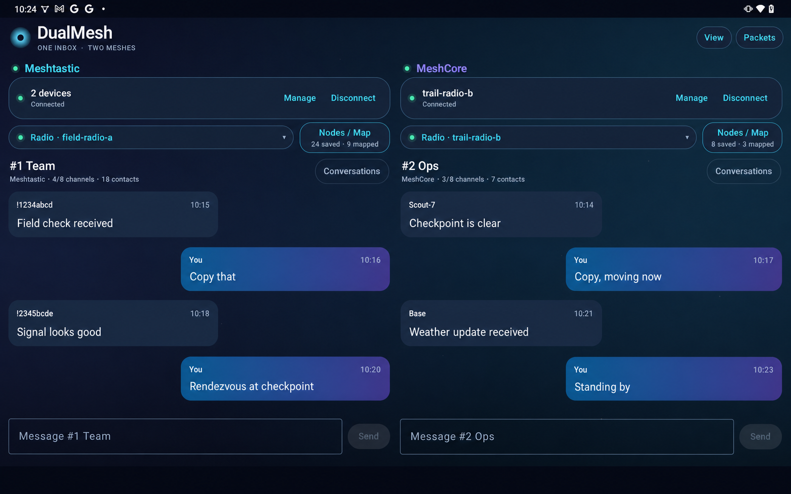
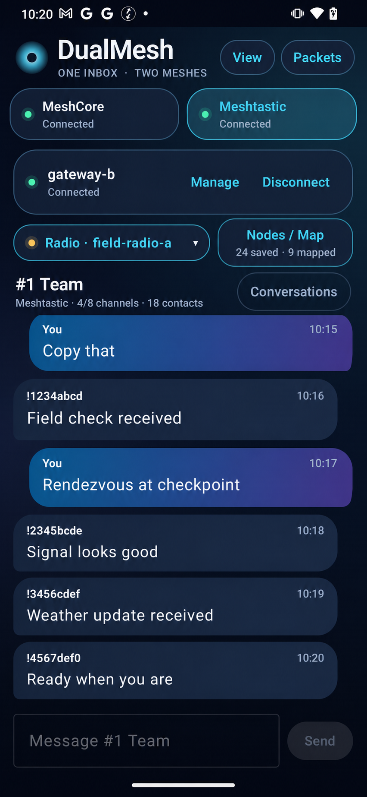
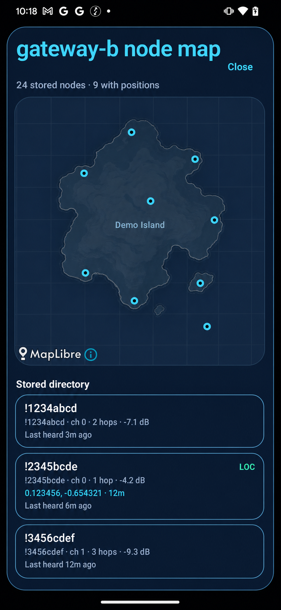
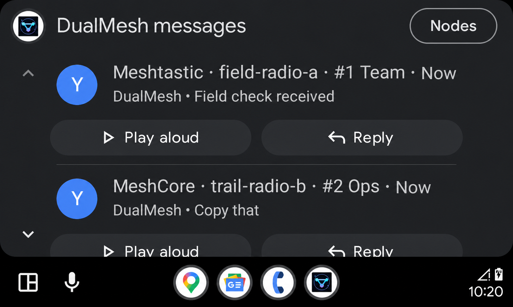
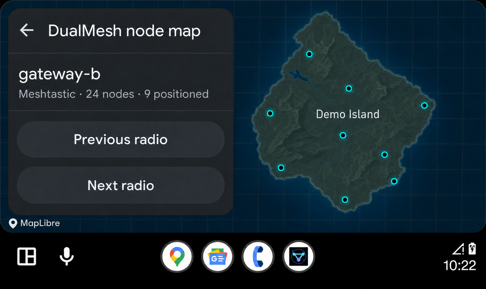

# DualMesh

[](https://github.com/logans-stuff/dualmesh/actions/workflows/android-apks.yml)

DualMesh is an experimental Android message app. It connects to MeshCore companion radios and
Meshtastic nodes.

DualMesh keeps the two mesh protocols separate. It does not forward traffic from one mesh to the
other mesh.

## Screenshots

The screenshots contain test data. They do not contain data from a real deployment.

<p>
  
</p>
<p>
  
  
</p>
<p>
  
  
</p>

## Quick start

1. Install the debug APK.
2. Give the app access to Nearby devices and notifications.
3. Select **Manage** in the applicable network pane.
4. Add a BLE radio.
5. For Meshtastic TCP, enter a host name or `host:port`.
6. If you do not enter a port, the app uses port `4403`.
7. Select a radio.
8. Select one of its channels or direct-message conversations.
9. Select **Nodes** or **Nodes / Map** to open the compact node list, then **Map** for positions.
10. Search by node name, ID, role, hardware, channel, or radio name. Use MC/MT chips and
    **Filters** to select networks, radios, node roles, and last-heard limits.
11. Star nodes to save favorites; use **★ Favorites** to filter them. Open a node for grouped
    details and **Trace route**, or use **Radio actions** to request stats and advertise.
12. For MeshCore contacts, use **Route > Set route** to edit direct, flood, or manual paths and
    discover a route to review before saving.

Enable **Packets** only when you must record protocol traffic.

WARNING: A packet log can contain keys, messages, node IDs, and locations.

### Meshtastic MQTT client proxy

DualMesh can use the phone's Internet connection as the MQTT gateway for each connected
Meshtastic radio, over BLE or TCP. Open that radio's **Settings > Module · MQTT** (or use the
Meshtastic app or CLI): enable **MQTT** and **Proxy to client enabled**, then set the broker, credentials,
TLS, and root topic. Enable channel **Uplink** and/or **Downlink** as needed.

Reconnect the radio in DualMesh after changing settings in another app. DualMesh reads these
settings from the radio and starts the proxy automatically. Open **Manage** to see each radio's
MQTT proxy status. Stop the radio connection, or disable its MQTT client proxy setting and
reconnect, to stop relaying.

The proxy supports binary packets, JSON topics, retained messages, and the PKI direct-message
topic. It reconnects to the broker after network loss. Each radio has its own broker session.
Broker credentials stay in memory for the connection. The radio controls encryption, uplink,
downlink, and map reporting; these can be edited under the radio's **Settings**.
The proxy does not queue traffic while the broker is offline, and it drops oversized packets
or excess downlink traffic when the radio transport is busy.

### Node statistics and announcements

Open **Nodes > Radio actions** and choose a connected radio. **Request stats** reads MeshCore
battery, uptime, radio, and packet statistics, or Meshtastic device telemetry and local stats.
Meshtastic node details also offer a remote **Request node stats** action. Results stay in memory
until disconnect and are never posted into chat.

**Zero-hop** and **Flood** send a MeshCore advert, or the equivalent Meshtastic user-info
broadcast with zero or configured hops. Actions use the radio you choose. Opening the node
list sends nothing automatically. See [nodes and maps](docs/NODES_AND_MAPS.md) for protocol
support and response behavior.

### Radio settings

Select a connected radio, then tap **Settings** beside its radio selector. DualMesh reads
settings once per connection and reuses them when you return. Tap **Refresh** for a full reread.
Open a section, edit its fields, and select **Save**.
Each save reads the current values first, changes only the edited fields, and reads the result
back. A write that times out, is rejected, or returns different values is shown as unverified;
refresh before retrying. RF and Bluetooth changes may interrupt the connection before readback.

Meshtastic supports identity, channels, and firmware-reported device and module settings,
including LoRa, position, power, network, display, Bluetooth, security, MQTT, and telemetry.
Scalar, enum, byte/key, and repeated scalar fields are editable. Repeated structured entries
are displayed read-only and preserved. Firmware access restrictions still apply.

MeshCore supports identity, RF parameters and power, location, privacy and telemetry policies,
channels, Bluetooth PIN, radio tuning, and firmware-supported contact, path-hash, and GPS/sensor
settings. Newer controls appear only when the radio reports their values.

Settings target the connected companion radio, not remote nodes over RF. Secrets and drafts are
kept in memory and masked in the editor. Nothing is sent until **Save** is selected.
Refresh reads configuration without changing it.

## Functions

- Connect a maximum of four radios for each mesh technology.
- Keep each radio, channel, contact, message, and map in its own data scope.
- Connect to MeshCore with BLE.
- Connect to Meshtastic with BLE or TCP.
- Read and edit settings on either connected radio, with acknowledged writes and readback.
- Proxy Meshtastic MQTT through the phone using each radio's MQTT configuration.
- Find the channels that each radio supplies.
- Send and receive channel messages.
- Send and receive direct messages.
- Show Meshtastic reactions below the related message.
- Save the newest 5,000 messages in SQLite.
- Save node details and the latest node positions for each radio.
- Search the node directory for each selected radio.
- Show both meshes on a full-screen street map with labeled MC/MT markers, node details,
  a filtered directory, and saved filters for unknown, MQTT, direct, offline, unheard, and
  infrastructure nodes.
- Run a traceroute from either technology and show its route and SNR data.
- Save the newest 1,000 traceroute results with their per-radio routes.
- Restore enabled radio connections after an app restart or device restart.
- Record optional protocol logs in JSONL files.
- Show one network or two stacked networks on a phone.
- Show both networks side by side on a tablet.
- Show message conversations in Android Auto.
- Show a node map on a private, stationary Android Auto head unit.

## Limits

- A radio can discard a queued packet before DualMesh receives it.
- Meshtastic keeps its normal app queue in node RAM.
- A node restart or deep sleep can remove queued Meshtastic packets.
- A sent state only means that the app gave the message to the radio.
- The app does not show a final mesh delivery receipt.
- Android or the device vendor can stop background start operations.
- Open DualMesh if Android does not restore the service after device start.
- The app saves a maximum of 12 known targets for each mesh technology.
- The app permits a maximum of four active targets for each mesh technology.
- A node map shows only positions that the mesh supplies.
- Map tiles require an Internet connection.
- The app does not include offline map files.
- A MeshCore contact with no saved path uses the contact hash as a direct trace hop.
- A MeshCore contact with a saved path uses that path to reach the contact and return.
- A trace can time out when the target is offline or does not return trace data.
- Android Auto voice input depends on the phone, host, account, and microphone.
- The private Android Auto setup is not a Google Play distribution method.
- The Android Auto node map is not an in-motion driver interface.

## Build

Install these tools:

- JDK 21
- Android SDK 37
- Android platform tools

Run:

```shell
export JAVA_HOME=/path/to/jdk-21
export PATH="$JAVA_HOME/bin:$PATH"

./gradlew testDebugUnitTest assembleDebug lintDebug
```

The build creates this file:

```text
app/build/outputs/apk/debug/app-debug.apk
```

Install the APK:

```shell
adb install -r app/build/outputs/apk/debug/app-debug.apk
```

A MeshCore radio must use companion firmware. A Meshtastic radio must supply its BLE service or
its TCP Stream API.

### GitHub Actions

The `Android APKs` workflow runs for changes to `main`, pull requests to `main`, and manual runs.
It runs the unit tests and Android lint. It builds these artifacts:

- an installable debug APK
- an unsigned release APK
- an Android lint report.

Open a completed workflow run in GitHub. Download the applicable artifact from the **Artifacts**
section. GitHub keeps each artifact for 30 days.

A successful `main` build also updates the
[Development build](https://github.com/logans-stuff/dualmesh/releases/tag/development) prerelease.
This prerelease contains the installable debug APK and its SHA-256 checksum. The APK uses Android
debug signing. It is not a production release.

## Documents

- [Visual design](docs/DESIGN.md)
- [Protocol design](docs/PROTOCOLS.md)
- [Nodes, contacts, and maps](docs/NODES_AND_MAPS.md)
- [Radio settings](docs/RADIO_SETTINGS.md)
- [Packet logs](docs/PACKET_LOGGING.md)
- [Privacy and security](docs/PRIVACY_AND_SECURITY.md)
- [Android Auto](docs/ANDROID_AUTO.md)
- [Tests](docs/TESTING.md)

## Source projects

- [meshcore-dev/MeshCore](https://github.com/meshcore-dev/MeshCore)
- [zjs81/meshcore-open](https://github.com/zjs81/meshcore-open)
- [meshtastic/firmware](https://github.com/meshtastic/firmware)
- [meshtastic/Meshtastic-Android](https://github.com/meshtastic/Meshtastic-Android)

DualMesh uses the official `org.meshtastic:protobufs` Wire artifact. Refer to each source project
for its license and protocol documents.

## License

GPL-3.0-or-later.
