# Current interface screenshots

Phone and tablet captures below were made from the actual Compose interface on 2026-11-03,
using an isolated `screenshots` build on a Pixel 10 Pro XL. Identities, radio addresses, messages,
reactions, routes, and positions are fictional. Map coordinates are examples in a public park;
they are not a deployment. The capture script uses Android status-bar demo mode for a fixed clock/battery and hidden
notification icons, then restores the previous demo settings. A temporary notification-icon
disable flag also handles ROMs that ignore the notifications demo command; it is cleared at exit.
These are native captures, without generated UI, pixel redaction, or image compositing.

## Channels

Connection actions are in Connections. Channels keeps a read-only source/status line, a tappable
chat heading, message history, delivery/reception metadata, reactions, and the composer.

<p>
  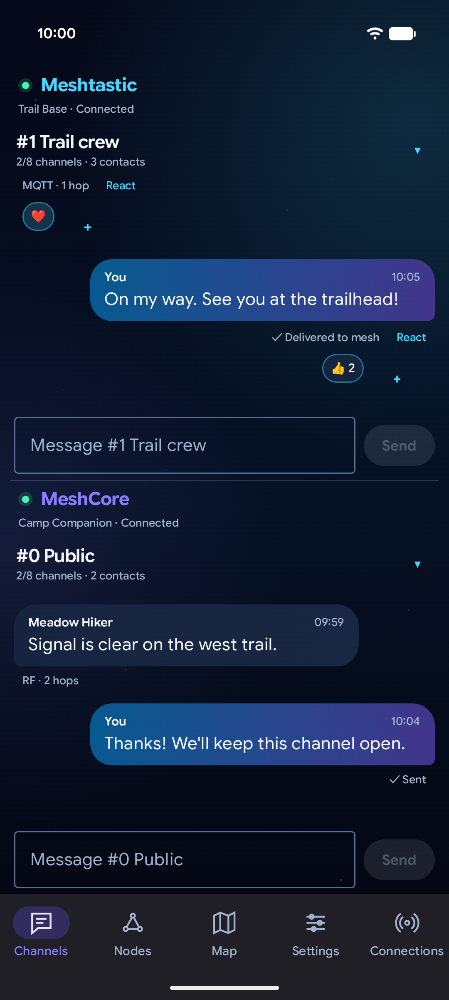
  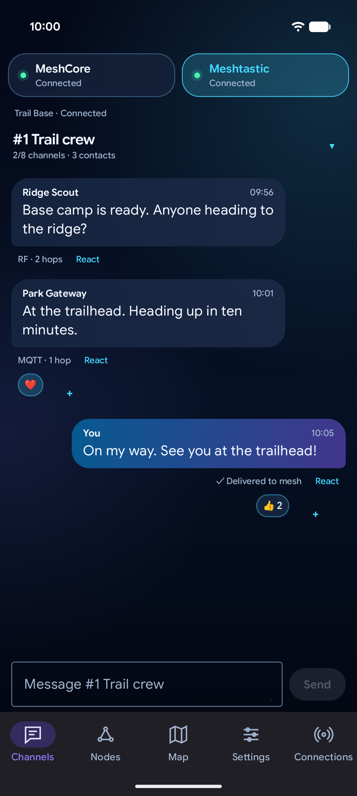
</p>

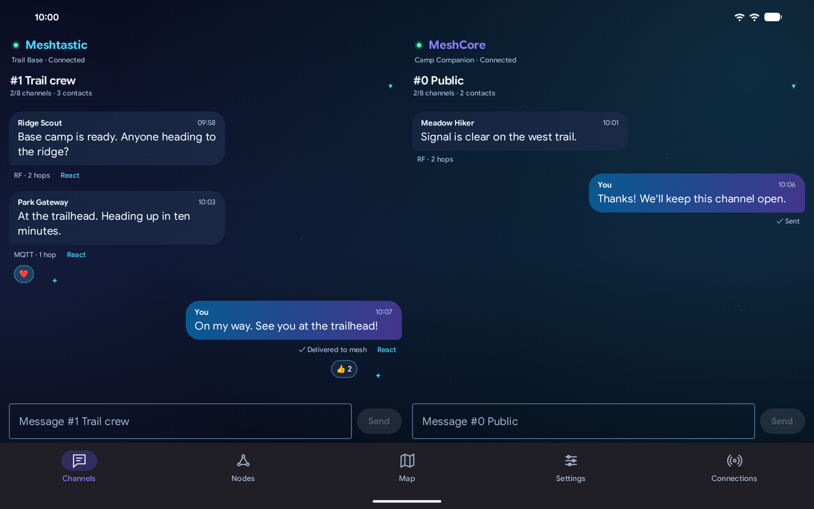

## Nodes and map

<p>
  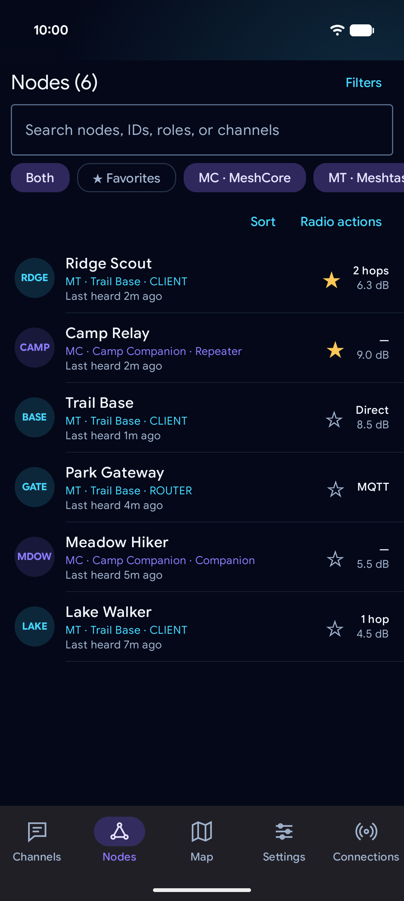
  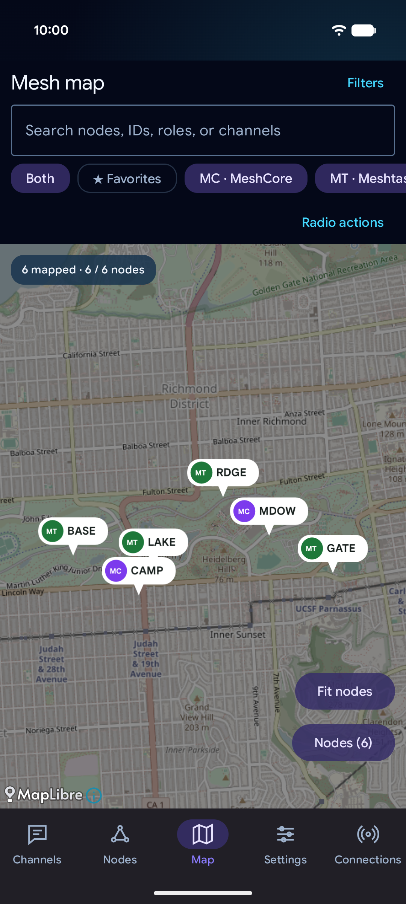
  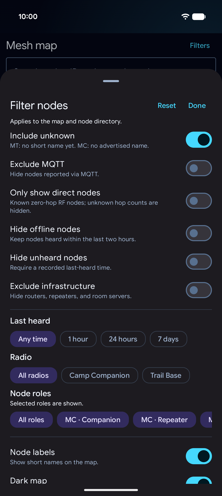
</p>
<p>
  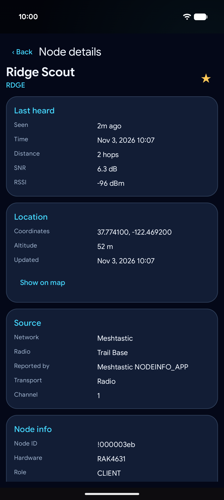
  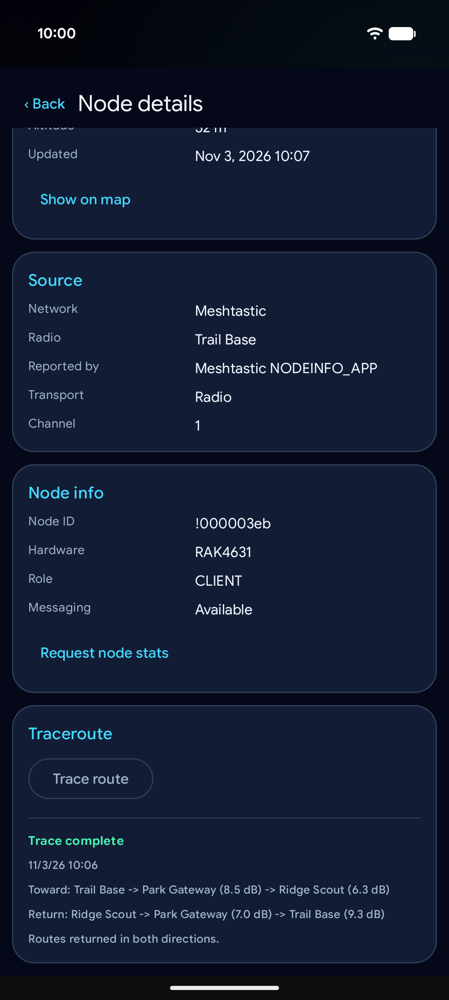
</p>

## Reactions, settings, and connections

<p>
  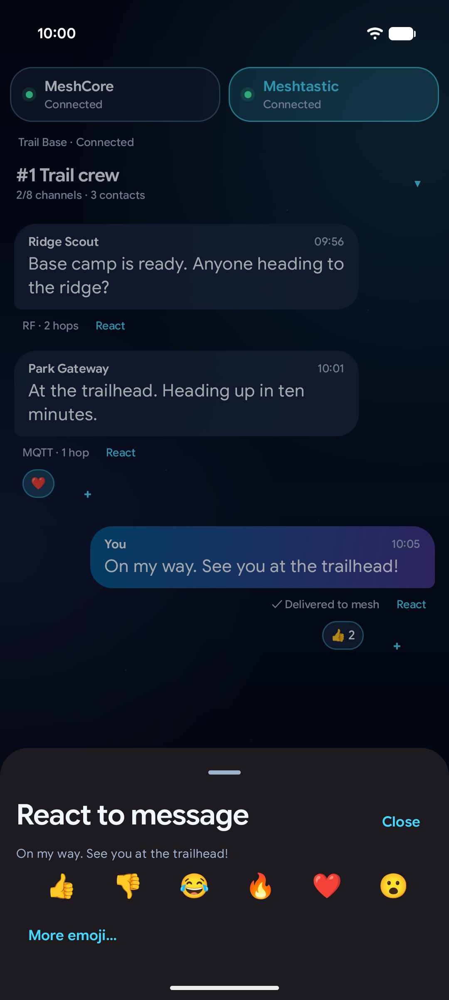
  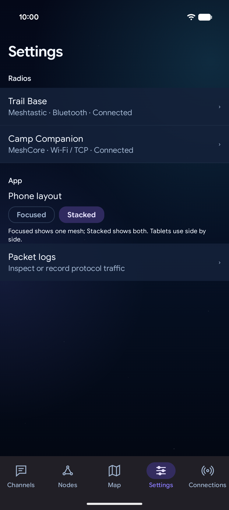
  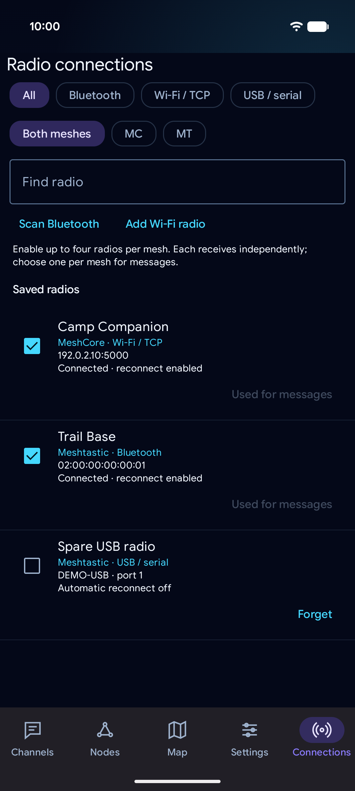
</p>

The existing Android Auto captures in the README illustrate its unchanged host templates.

## Capture again

Build the fixture APK:

```shell
./gradlew assembleScreenshots
python3 scripts/capture-screenshots.py --serial YOUR_DEVICE_SERIAL
```

Use an unlocked phone, and `--adb /path/to/adb` if needed. The fixture window stays awake only
while it is visible. The script installs `io.dualmesh.app.screenshots` beside the
normal app. It clears only that fixture package, injects fictional in-memory state after its
empty history has loaded, and navigates the real screens. No radio sessions or message sends
are created. The fixture entry point and data exist only in `src/screenshots`; they are excluded
from normal debug/release APKs. Fixture injection uses private flow fields so the production API
does not acquire a demo-data hook; update the fixture if those fields are renamed.

Phone captures use the device's normal display settings. The tablet capture temporarily uses
1920×1200 at 240 dpi. Exact prior size/density overrides and status-bar demo settings are restored in `finally`, and the fixture
app is removed when finished (use `--keep-app` to retain it). The script then returns to the
normal installed app. It never clears, uninstalls, seeds, or changes the normal app's history or
preferences. PNG transfers are checked for completeness, and capture stops if another app or a
system text overlay is visible. Inspect every image before committing it.
